# 🔒 Zero-Trust Kubernetes GitOps & Supply Chain Security (SLSA Level 3)

[](https://kubernetes.io)
[](https://argoproj.github.io/cd/)
[](https://sigstore.dev)
[](https://kyverno.io)
[](https://cilium.io)
[](https://slsa.dev)
[](https://github.com/shrutibawase/zero-trust-k8s-gitops/releases/tag/v1.0.0)
[](LICENSE)

> **Architected by:** [Shruti Bawase](https://github.com/shrutibawase)  
> **Production Caliber:** End-to-End Cryptographic Container Signing (Keyless OIDC), SBOM Attestation (Syft SPDX/CycloneDX), Kyverno Admission Verification, Cilium eBPF L7 Microsegmentation, and ArgoCD Self-Healing GitOps.

---

## 🏛️ Architecture Overview

```mermaid
flowchart LR
    subgraph CI["🚀 Shift-Left Supply Chain Pipeline (GitHub Actions)"]
        COMMIT["Git Commit"] --> LINT["GitLeaks & Checkov"]
        LINT --> BUILD["Distroless Docker Build"]
        BUILD --> SCAN["Trivy CVE Scan (Exit on High/Crit)"]
        SCAN --> SBOM["Syft SBOM (SPDX/CycloneDX)"]
        SBOM --> SIGN["Sigstore Cosign Signing (Keyless OIDC)"]
    end

    subgraph ADMISSION["🛡️ Kubernetes Admission Gatekeeper"]
        KYVERNO["Kyverno Admission Controller\n(Verify Cosign Signature & Non-Root)"]
    end

    subgraph RUNTIME["☸️ Production Cluster (Cilium eBPF)"]
        POD["Hardened Microservice Pod\n(ReadOnlyRootFS, Drop ALL Caps, Non-Root)"]
        NETPOL["Cilium L7 Network Policy\n(Default-Deny Ingress/Egress, DNS-Only)"]
    end

    SIGN -->|Push Signed OCI Image| GHCR["GitHub Container Registry"]
    GHCR --> KYVERNO
    KYVERNO -- Verified --> POD
    POD --- NETPOL

    classDef stage fill:#0d1117,stroke:#38bdf8,stroke-width:1.5px,color:#fff;
    classDef gate fill:#3b0764,stroke:#a855f7,stroke-width:2px,color:#fff;
    classDef runtime fill:#064e3b,stroke:#10b981,stroke-width:2px,color:#fff;

    class CI stage;
    class ADMISSION gate;
    class RUNTIME runtime;
```



---

## 📚 Engineering Documentation Index

| Module / Topic | Guide Link | Focus Areas |
|---|---|---|
| **Industry Compliance** | [Compliance Matrix](file:///D:/project/antigravity/zero-trust-k8s-gitops/docs/compliance-matrix.md) | NIST SP 800-207, CIS K8s v1.8, SLSA L3, OWASP K8s |
| **Supply Chain Security** | [SLSA Level 3 Guide](file:///D:/project/antigravity/zero-trust-k8s-gitops/docs/slsa-level-3-guide.md) | Keyless Cosign, Syft SBOMs, Trivy/Grype gates, Provenance |
| **Cluster Automation** | [Bootstrap & Testing Guide](file:///D:/project/antigravity/zero-trust-k8s-gitops/docs/cluster-bootstrap-and-testing-guide.md) | Multi-node Kind, Cilium eBPF, Kubeconform, E2E Smoke Tests |
| **eBPF Networking** | [Cilium eBPF Guide](file:///D:/project/antigravity/zero-trust-k8s-gitops/docs/cilium-ebpf-networking-guide.md) | Wire mTLS, L7 DNS proxies, HTTP filtering, Hubble |
| **Policy-as-Code** | [Policy Governance Guide](file:///D:/project/antigravity/zero-trust-k8s-gitops/docs/policy-as-code-guide.md) | Kyverno PSS Restricted, Mutating contexts, CLI testing |
| **Declarative GitOps** | [ArgoCD Architecture Guide](file:///D:/project/antigravity/zero-trust-k8s-gitops/docs/gitops-argocd-guide.md) | App-of-Apps, ApplicationSets, Hooks, Notifications |
| **Incident Response** | [Incident Runbook](file:///D:/project/antigravity/zero-trust-k8s-gitops/docs/incident-response-runbook.md) | Kyverno admission triage, Cilium packet drop debugging |
| **Milestone History** | [Changelog](file:///D:/project/antigravity/zero-trust-k8s-gitops/CHANGELOG.md) | Complete version `v1.0.0` deliverables across all 7 days |

---

## ⚡ Quickstart & Testing Matrix

### 1. Automated Cluster Lifecycle
```bash
# Bootstrap local Kind cluster with Cilium eBPF, Kyverno, and ArgoCD
./scripts/setup-kind-cluster.sh       # Linux / macOS
.\scripts\setup-kind-cluster.ps1     # Windows PowerShell

# Destroy and prune cluster resources
./scripts/teardown-kind-cluster.sh    # Linux / macOS
.\scripts\teardown-kind-cluster.ps1   # Windows PowerShell
```

### 2. Automated Test Runners
```bash
# 1. Helm Chart Invariant & Lint Tests
./scripts/test-charts.sh             # Linux / macOS
.\scripts\test-charts.ps1            # Windows PowerShell

# 2. Kyverno Policy-as-Code Tests
./scripts/test-policies.sh           # Linux / macOS
.\scripts\test-policies.ps1          # Windows PowerShell

# 3. Cilium eBPF Network Isolation Tests
./scripts/test-networking.sh         # Linux / macOS
.\scripts\test-networking.ps1        # Windows PowerShell

# 4. SLSA Level 3 Supply Chain Security Tests
./scripts/test-supply-chain.sh       # Linux / macOS
.\scripts\test-supply-chain.ps1      # Windows PowerShell

# 5. Full End-to-End Cluster Smoke Tests
./scripts/e2e-smoke-test.sh          # Linux / macOS
.\scripts\e2e-smoke-test.ps1         # Windows PowerShell
```

### 3. Image Signature & Provenance Verification
```bash
# Verify container cryptographic signature, SPDX SBOM, and SLSA provenance
./scripts/verify-image.sh ghcr.io/shrutibawase/zero-trust-k8s-gitops:latest
.\scripts\verify-image.ps1 ghcr.io/shrutibawase/zero-trust-k8s-gitops:latest
```

---

## 📁 Repository Layout

```
zero-trust-k8s-gitops/
├── .github/workflows/                 # Automated CI/CD Pipelines
│   ├── helm-lint-and-validate.yml     # Helm Lint & Kubeconform Schema Validation
│   ├── policy-and-manifest-validation.yml # Checkov & Kyverno CLI Policy Analysis
│   └── supply-chain-security.yml      # Syft SBOM, Trivy/Grype Gates & Cosign Signing
├── charts/secure-microservice/        # Production Hardened Helm Chart (PSS Restricted)
├── cluster/                           # Declarative Multi-Node Kind Cluster Specs
├── docs/                              # Comprehensive Architectural Runbooks & Guides
├── gitops/                            # ArgoCD App-of-Apps, ApplicationSets & Alerts
├── networking/cilium/                 # Cilium eBPF L7 Policies, Wire mTLS & Hubble
├── policies/kyverno/                  # Kyverno Zero-Trust Admission & Mutating Rules
├── scripts/                           # Cross-Platform Bash & PowerShell Automation
├── security/                          # SLSA L3 Predicates, SBOM & Scanner Configs
├── CHANGELOG.md                       # Release v1.0.0 Milestone History
├── LICENSE                            # Open-Source MIT License
└── README.md                          # Repository Documentation & Architecture
```

---

## 📜 License

Distributed under the **MIT License**. See [`LICENSE`](LICENSE) for complete details.
