```mermaid
flowchart LR
    subgraph CI["🚀 Shift-Left Supply Chain Pipeline (GitHub Actions)"]
        COMMIT["Git Commit"] --> LINT["GitLeaks & Checkov"]
        LINT --> BUILD["Distroless Docker Build"]
        BUILD --> SCAN["Trivy CVE Scan (Exit on High/Crit)"]
        SCAN --> SBOM["Syft SBOM (SPDX/CycloneDX)"]
        SBOM --> SIGN["Sigstore Cosign Signing (Keyless OIDC)"]
    end

    subgraph ADMISSION["🛡️ Kubernetes Admission Gatekeeper"]
        KYVERNO["Kyverno Admission Controller\n(Verify Cosign Signature & Non-Root)"]
    end

    subgraph RUNTIME["☸️ Production Cluster (Cilium eBPF)"]
        POD["Hardened Microservice Pod\n(ReadOnlyRootFS, Drop ALL Caps, Non-Root)"]
        NETPOL["Cilium L7 Network Policy\n(Default-Deny Ingress/Egress, DNS-Only)"]
    end

    SIGN -->|Push Signed OCI Image| GHCR["GitHub Container Registry"]
    GHCR --> KYVERNO
    KYVERNO -- Verified --> POD
    POD --- NETPOL

    classDef stage fill:#0d1117,stroke:#38bdf8,stroke-width:1.5px,color:#fff;
    classDef gate fill:#3b0764,stroke:#a855f7,stroke-width:2px,color:#fff;
    classDef runtime fill:#064e3b,stroke:#10b981,stroke-width:2px,color:#fff;

    class CI stage;
    class ADMISSION gate;
    class RUNTIME runtime;
```

# 🔒 Zero-Trust Kubernetes GitOps & Supply Chain Security (SLSA Level 3)

[](https://kubernetes.io)
[](https://argoproj.github.io/cd/)
[](https://sigstore.dev)
[](https://kyverno.io)
[](https://cilium.io)

> **Architected by:** [Shruti Bawase](https://github.com/shrutibawase)  
> **Production Caliber:** End-to-End Cryptographic Container Signing (Keyless OIDC), SBOM Attestation (Syft SPDX/CycloneDX), Kyverno Admission Verification, Cilium eBPF L7 Microsegmentation, and ArgoCD Self-Healing GitOps.

---

## 🏛️ Zero-Trust Architecture Overview



---

## 🚀 Key Security Pillars

1. **SLSA Level 3 Supply Chain Assurance**:
   - Every container image is built from verified Git SHAs.
   - Images are cryptographically signed using **Sigstore Cosign** via GitHub Actions OIDC tokens (no long-lived signing keys to leak).
   - Software Bill of Materials (SBOM) in SPDX and CycloneDX formats generated using **Syft** and attested directly onto the OCI image layer.
2. **Kyverno Admission Controller Enforcement**:
   - `check-image-cosign-signature`: Intercepts admission requests and refuses pod creation if the image is unsigned or tampered with.
   - `disallow-root-user`: Enforces `runAsNonRoot: true` across all pods in the cluster.
3. **Cilium eBPF Layer 7 Microsegmentation**:
   - Default-deny all incoming and outgoing cluster traffic.
   - Explicitly whitelists HTTP routes (`/healthz`, `/api/v1/*`) and restricts egress strictly to port 53 DNS and the internal database subnet.
4. **Declarative GitOps with ArgoCD**:
   - Continuous drift reconciliation: manual cluster edits are automatically overwritten back to Git baseline within seconds.

---

## 📁 Repository Layout

```
zero-trust-k8s-gitops/
├── .github/
│   └── workflows/
│       └── supply-chain-security.yml  # Buildx, Trivy, Syft SBOM & Cosign Signing
├── charts/
│   └── secure-microservice/           # Production Hardened Helm Chart
│       ├── Chart.yaml
│       ├── values.yaml
│       └── templates/
│           ├── deployment.yaml        # ReadOnlyRootFS, NonRoot, Cap Drop ALL
│           └── service.yaml
├── policies/
│   └── kyverno/                       # Zero-Trust Admission Policies
│       ├── disallow-root-user.yaml
│       └── require-cosign-image-signature.yaml
├── networking/
│   └── cilium/
│       └── cilium-network-policy.yaml # L7 eBPF Microsegmentation
├── gitops/
│   └── root-app.yaml                  # ArgoCD App-of-Apps Declarative Sync
├── Dockerfile                         # Multi-stage distroless static build
└── README.md
```

---

## 🛠️ Deployment & Verification

### 1. Verify Kyverno Image Verification Policy
```bash
kubectl apply -f policies/kyverno/require-cosign-image-signature.yaml
```

### 2. Apply Cilium eBPF Network Microsegmentation
```bash
kubectl apply -f networking/cilium/cilium-network-policy.yaml
```

### 3. Deploy via ArgoCD GitOps
```bash
kubectl apply -f gitops/root-app.yaml
```
