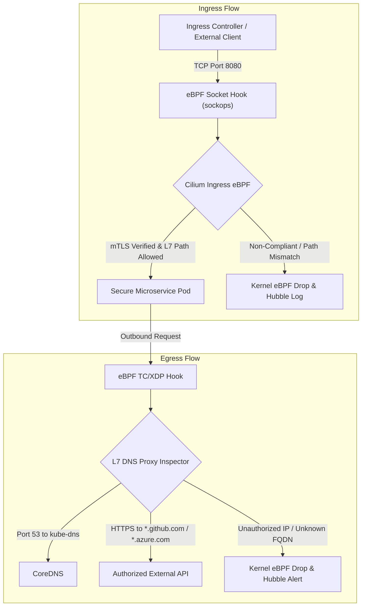

# 🌐 Cilium eBPF Zero-Trust Networking & Microsegmentation Guide

This guide details the kernel-level network microsegmentation, layer-7 protocol filtering, sidecar-free mutual TLS (mTLS), and Hubble telemetry enforced by **Cilium eBPF**.

---

## 🏛️ eBPF Kernel Datapath Architecture

Traditional Kubernetes network policies rely on iptables, which suffer from $O(N)$ linear rule evaluation delays and lack layer-7 context. Cilium bypasses iptables entirely by compiling BPF bytecode directly into the Linux socket layer:



---

## 🛡️ Microsegmentation Policy Suite

| Policy File | Security Function | Target Scope |
|---|---|---|
| `default-deny-all.yaml` | Baseline isolation dropping all unapproved ingress/egress flows | Entire `zero-trust-prod` namespace |
| `dns-aware-egress.yaml` | Restricts outbound traffic to approved FQDNs with DNS proxying | Pods matching `app.kubernetes.io/name: secure-microservice` |
| `ebpf-mutual-tls.yaml` | Enforces cryptographic mTLS authentication without sidecars | Pod-to-pod ingress/egress |
| `l7-http-rules.yaml` | Restricts HTTP methods (`GET`, `POST`) and regex URI paths | Application container port 8080 |
| `hubble-telemetry.yaml` | Exposes dropped flow counts, TCP resets, and DNS latency on port 9965 | Prometheus scrape targets |

---

## 🔭 Hubble Observability Runbook

Hubble allows operators to inspect network flows in real-time directly from the Linux kernel.

### 1. View Dropped Network Packets in Real-Time
```bash
hubble observe -n zero-trust-prod --verdict DROPPED --follow
```

### 2. Audit Outbound DNS Queries
```bash
hubble observe -n zero-trust-prod --type dns --follow
```

### 3. Verify Layer-7 HTTP Filtered Requests
```bash
hubble observe -n zero-trust-prod --protocol http
```

### 4. Run Automated Policy Verification Tests
```bash
# Bash
./scripts/test-networking.sh

# PowerShell
.\scripts\test-networking.ps1
```
