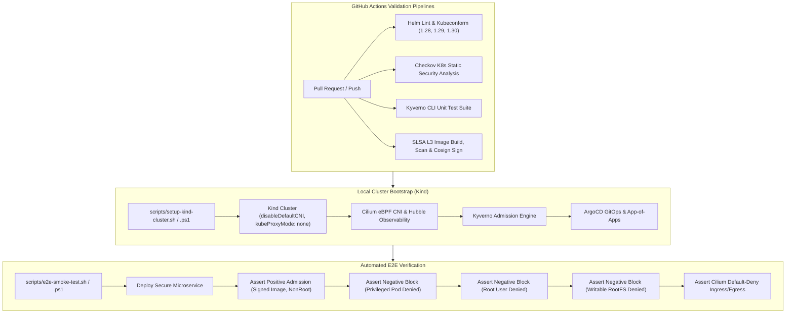

# Zero-Trust Cluster Bootstrap, CI/CD Automation & End-to-End Testing Guide

## 1. Overview & Architecture

This guide covers the automated lifecycle of the **Zero-Trust Kubernetes platform**, from local multi-node cluster provisioning with eBPF to automated CI/CD validation and runtime security smoke testing.



---

## 2. CI/CD Automation Pipelines

Our GitHub Actions automation ensures that no misconfigured Helm charts, invalid Kubernetes manifests, or vulnerable container images can merge into `main`:

| Workflow File | Trigger Paths | Validation Engines | Scope |
|---|---|---|---|
| `.github/workflows/helm-lint-and-validate.yml` | `charts/**` | `helm lint --strict`, `kubeconform` (K8s 1.28, 1.29, 1.30) | Validates chart syntax, values variations, and schema compliance |
| `.github/workflows/policy-and-manifest-validation.yml` | `policies/**`, `gitops/**`, `networking/**` | `kyverno test`, `checkov` | Enforces policy invariants and scans for CIS Benchmark gaps |
| `.github/workflows/supply-chain-security.yml` | Root code, Dockerfile, scripts | GitLeaks, Trivy, Syft, Grype, Cosign | Attests SLSA Level 3 provenance, generates SBOMs, and signs images |

---

## 3. One-Click Cluster Provisioning

To bootstrap an enterprise-parity local cluster with Cilium eBPF, Kyverno, and ArgoCD:

### Linux / macOS
```bash
./scripts/setup-kind-cluster.sh
```

### Windows PowerShell
```powershell
.\scripts\setup-kind-cluster.ps1
```

The script automatically executes:
1. Verifies prerequisites: `docker`, `kind`, `kubectl`, `helm`.
2. Creates a 3-node Kind cluster (`cluster/kind-config.yaml`) with `/sys/fs/bpf` kernel mounts and port-forwarding for Ingress and Hubble.
3. Installs Cilium CNI v1.15+ with `kubeProxyReplacement=true` and Hubble Relay.
4. Installs Kyverno v3.1+ admission controller in the `kyverno` namespace.
5. Installs ArgoCD v2.10+ and applies `gitops/root-app.yaml` to begin continuous reconciliation.

---

## 4. End-to-End Security Smoke Testing

Once the cluster is running, execute the automated E2E test suite:

### Linux / macOS
```bash
./scripts/e2e-smoke-test.sh
```

### Windows PowerShell
```powershell
.\scripts\e2e-smoke-test.ps1
```

### Test Assertions Evaluated:
1. **API Reachability:** Verifies cluster control plane readiness.
2. **Admission Controller Readiness:** Verifies Kyverno webhook pods are active.
3. **Valid Workload Admission:** Deploys `secure-microservice` and verifies successful scheduling under PSS Restricted.
4. **Privileged Pod Rejection:** Verifies Kyverno blocks `privileged: true` pods.
5. **Root User Rejection:** Verifies Kyverno blocks `runAsUser: 0` pods.
6. **Writable RootFS Rejection:** Verifies Kyverno blocks `readOnlyRootFilesystem: false` pods.
7. **Cilium Network Isolation:** Verifies default-deny network policy application.

---

## 5. ArgoCD Notifications & Real-Time Alerting

The cluster is pre-configured with `gitops/argocd-notifications-cm.yaml`:
- Alerts on application synchronization failures (`on-sync-failed`).
- Alerts when health state degrades (`on-health-degraded`).
- Notifies development channels on successful deployment verification (`on-deployed`).
