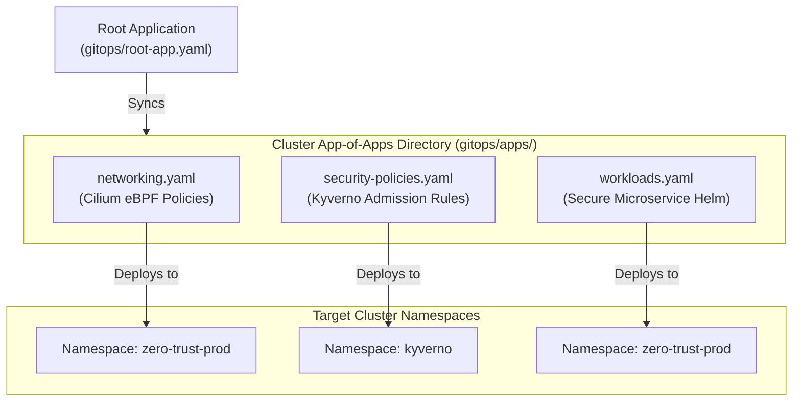

# 🐙 ArgoCD GitOps Engine & App-of-Apps Architecture

This guide details the declarative continuous delivery, automated drift reconciliation, and change control mechanisms implemented via **ArgoCD**.

---

## 🏛 App-of-Apps Hierarchy



---

## 🌊 Sync Waves & Lifecycle Hooks

To guarantee zero-downtime database schema integrity and post-deployment validation, resources are orchestrated using ArgoCD sync waves:

```
[Sync Wave -1] ───► [Sync Wave 0] ──────────► [Sync Wave 1] ────────► [Sync Wave 5]
 PreSync Job         ConfigMaps & Secrets      Deployments & Svcs      PostSync Smoke Test
 (DB Schema Check)   (Opaque Secrets)          (Workload Rollout)      (Internal Healthcheck)
```

1. **PreSync Hook (`sync-wave: -1`)**: Runs `pre-sync-db-migration.yaml`. The new application container will NOT deploy if migrations fail.
2. **Core Rollout (`sync-wave: 1`)**: Deploys updated pods, service endpoints, ingress routes, and resource quotas.
3. **PostSync Hook (`sync-wave: 5`)**: Runs `post-sync-smoke-test.yaml` to verify cluster endpoints before marking the application as `Synced` and `Healthy`.

---

## 📅 Production Sync Windows (Change Freeze)

Defined in `gitops/project-production.yaml`:
- **Weekend Change Freeze (`kind: deny`)**: Blocks all production synchronization from Friday 6:00 PM to Monday 6:00 AM (60-hour lock).
- **Approved Release Window (`kind: allow`)**: Permits deployments Monday through Thursday between 10:00 AM and 3:00 PM UTC.

---

## 🔍 Custom Lua Health Checks

ArgoCD out-of-the-box does not know how to evaluate custom resources like `CiliumNetworkPolicy` or `ClusterPolicy`. We inject custom Lua assessment scripts via `gitops/argocd-cm.yaml`:
- **Cilium Policies**: Evaluated as `Healthy` when kernel eBPF bytecode is generated and active across all endpoints.
- **Kyverno Rules**: Evaluated as `Healthy` once the admission webhook acknowledges policy registration.
