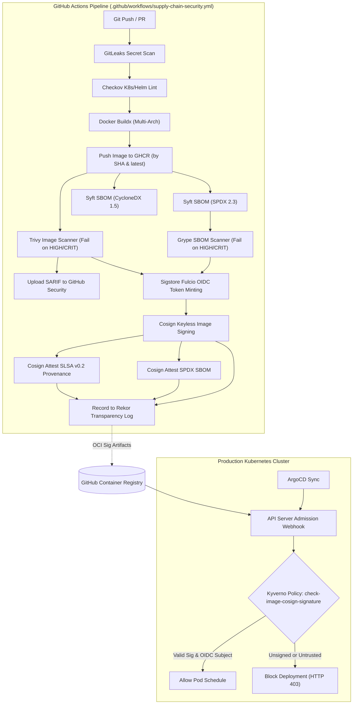

# SLSA Level 3 Supply Chain Security Architecture & Operator Runbook

## 1. Executive Overview & Threat Model

In modern cloud-native environments, compromises frequently occur before code reaches Kubernetes—via compromised dependencies, poisoned build environments, or unauthorized container images pushed to registries (e.g., SolarWinds, Codecov).

This repository implements **SLSA (Supply-chain Levels for Software Artifacts) Level 3** compliance, ensuring:
- **Build Isolation:** Builds execute exclusively on dedicated GitHub Actions hosted runners.
- **Source Integrity:** Every artifact is immutably mapped to a cryptographically verified Git commit SHA.
- **Keyless Signing:** Digital signatures are generated using short-lived X.509 certificates tied to GitHub OIDC tokens (eliminating static credentials).
- **Dual-Standard SBOM:** Automated generation of both **SPDX 2.3** (legal & compliance) and **CycloneDX 1.5** (vulnerability correlation).
- **Vulnerability Gating:** Build-time enforcement blocking images with `CRITICAL` or `HIGH` vulnerabilities.
- **Runtime Admission Control:** In-cluster enforcement via **Kyverno** rejecting any Pod whose container image lacks a valid Sigstore signature.

---

## 2. Architecture & Pipeline Sequence



---

## 3. Technology Stack & Standard Specifications

| Layer | Tooling | Standard / Format | Function |
|---|---|---|---|
| **Secret Scanning** | GitLeaks | Regex patterns | Prevents credential leaks in commits |
| **IaC Security** | Checkov | CIS Benchmark / OPA | Validates Helm and K8s manifests |
| **Container Engine** | Docker Buildx | OCI Image Specification | Builds reproducible microservice containers |
| **SBOM Generation** | Anchore Syft | SPDX 2.3 & CycloneDX 1.5 | Catalogs OS and language dependencies |
| **Vulnerability Gate** | Anchore Grype & Aqua Trivy | SARIF / CVE databases | Fails build on `CRITICAL` or `HIGH` CVEs |
| **Code Signing** | Sigstore Cosign | OIDC + Fulcio Root CA | Signs digest with ephemeral X.509 certs |
| **Transparency Log** | Sigstore Rekor | Append-only Merkle Tree | Immutable audit log of all signatures |
| **Provenance** | In-toto / SLSA | `https://slsa.dev/provenance/v0.2` | Attests to builder identity, commit, and params |
| **Admission Control**| Kyverno | `ClusterPolicy` (Enforce) | Blocks unsigned images at cluster admission |

---

## 4. Operator CLI Runbook

### 4.1 Verify Container Signature

```bash
cosign verify \
  --certificate-identity-regexp "^https://github.com/shrutibawase/.*" \
  --certificate-oidc-issuer "https://token.actions.githubusercontent.com" \
  ghcr.io/shrutibawase/zero-trust-k8s-gitops:latest
```

### 4.2 Verify SBOM Attestation

```bash
cosign verify-attestation \
  --type spdxjson \
  --certificate-identity-regexp "^https://github.com/shrutibawase/.*" \
  --certificate-oidc-issuer "https://token.actions.githubusercontent.com" \
  ghcr.io/shrutibawase/zero-trust-k8s-gitops:latest
```

### 4.3 Verify SLSA Level 3 Provenance

```bash
cosign verify-attestation \
  --type "https://slsa.dev/provenance/v0.2" \
  --certificate-identity-regexp "^https://github.com/shrutibawase/.*" \
  --certificate-oidc-issuer "https://token.actions.githubusercontent.com" \
  ghcr.io/shrutibawase/zero-trust-k8s-gitops:latest
```

### 4.4 Automated Testing

Run the supply chain test suite locally:

```bash
# Linux / macOS
./scripts/test-supply-chain.sh

# Windows PowerShell
.\scripts\test-supply-chain.ps1
```

---

## 5. Troubleshooting & FAQ

### Issue: `error: no signatures found`
- **Cause:** Image was pushed manually or outside the authorized GitHub Actions workflow.
- **Remediation:** Trigger the pipeline via `git push origin main` or execute local verification with the specific commit SHA digest.

### Issue: `x509: certificate has expired`
- **Explanation:** In Sigstore keyless signing, Fulcio certificates expire after 10 minutes. Cosign verifies the signature timestamp against the **Rekor transparency log entry**, proving the signature was minted while the certificate was valid. Ensure the host has network connectivity to `rekor.sigstore.dev`.
