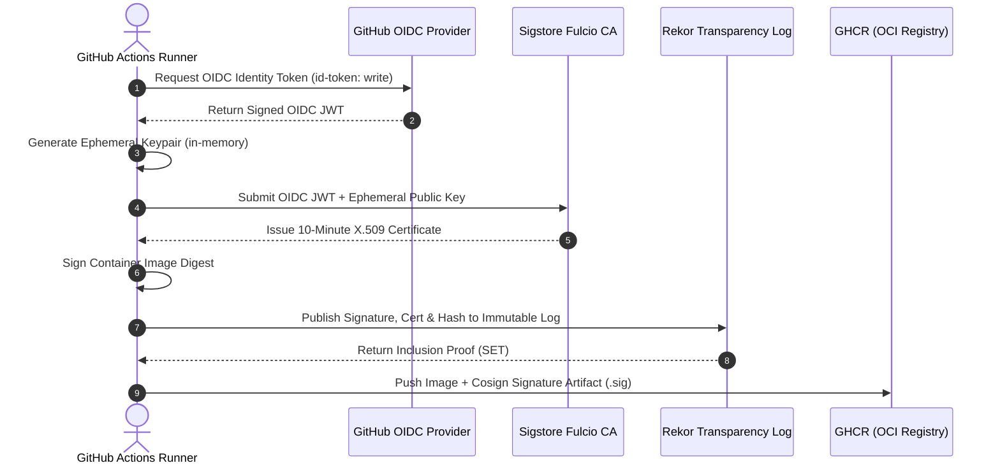

# Sigstore Cosign Keyless Image Signing Architecture

This module implements **cryptographic signature verification** for all OCI container images produced by the CI/CD pipeline, adhering to the **SLSA (Supply-chain Levels for Software Artifacts) Level 3** standard.

---

## 1. Keyless Signing Workflow (OIDC + Fulcio + Rekor)

Traditional container signing relies on static, long-lived GPG or asymmetric private keys stored in CI secrets, which are prone to leaks and operational complexity.

Our zero-trust pipeline uses **Sigstore keyless signing**:

1. **OIDC Token Minting:** When GitHub Actions runs, GitHub's OIDC Identity Provider (`https://token.actions.githubusercontent.com`) mints a short-lived JSON Web Token (JWT) attesting to the repository name, workflow file, commit SHA, and trigger actor.
2. **Ephemeral Keypair Generation:** The `cosign` CLI generates an ephemeral public/private keypair in memory.
3. **Fulcio Certificate Authority:** Cosign submits the OIDC JWT and ephemeral public key to the **Fulcio** root CA. Fulcio verifies the token and issues a short-lived X.509 certificate (valid for 10 minutes) binding the container signer to the identity:
   - **Issuer:** `https://token.actions.githubusercontent.com`
   - **Subject:** `https://github.com/shrutibawase/zero-trust-k8s-gitops/.github/workflows/supply-chain-security.yml@refs/heads/main`
4. **Signature Creation:** The container image is signed using the ephemeral private key.
5. **Rekor Transparency Log:** The signature, public key, and certificate are recorded in **Rekor**, an append-only, tamper-evident transparency log. The ephemeral private key is immediately discarded.
6. **OCI Registry Storage:** The signature is uploaded to GitHub Container Registry (GHCR) alongside the image digest (`.sig` artifact).



---

## 2. Verification Command

To verify any container image signed by this workflow, run:

```bash
cosign verify \
  --certificate-identity-regexp "^https://github.com/shrutibawase/.*" \
  --certificate-oidc-issuer "https://token.actions.githubusercontent.com" \
  ghcr.io/shrutibawase/zero-trust-k8s-gitops:<TAG>
```
